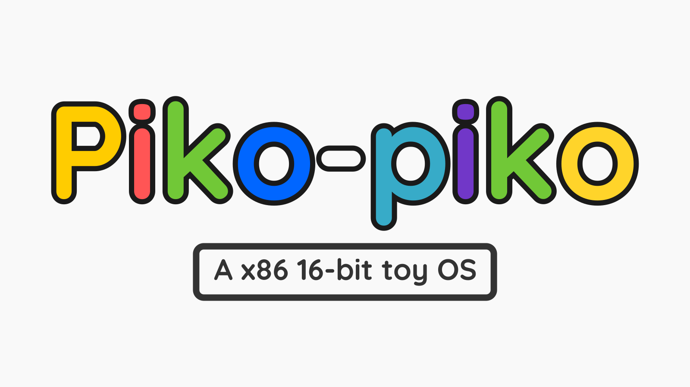

# Piko-piko OS

[](https://justforfunnoreally.dev)



> A simplistic, minimalistic, 16-bit toy OS.
> Perfect for entertainment & education.
> 0 practicality, 100% messing around.
>
> _From the author, Richie Kho_

Packed with a bootloader and an interpreter, it is able to run the commands like how
BASIC does in the 80s. It is much user-unfriendly as the language is closer to
assembly. It can:

- Do basic arithmetics (`add`, `sub`, `mul` & `div`)
- Do conditional jumps (`jse`, `jsne`, `jue`,...)
- Save and load (`save` & `load`)
- And most importantly, print colorful text (`say`)

All the commands are in [the commands reference](https://github.com/RechieKho/piko-piko/wiki/commands-reference).

You are very welcome to fork this project and add your own commands.

It is written in _pure_ [nasm](https://www.nasm.us/) assembly, so brace yourself.

## Hello world in Piko-piko

First, clone the project if you haven't do it [as stated in 'Build the source' section](#build-from-source).

Then, enter the world of Piko-piko.

```sh
$ make
```

At this point, you'll see "Welcome to piko-piko!" printed on the screen proceeds with `>`. Welcome to Piko-piko!

Then, type this command to print "Hello world!".

```sh
> say n 'Hello world!'
```

Yay, your first "Hello world!" in Piko-piko!

Let's spice things up by making our "Hello world!" colorful!

```sh
> say Cn 'Hello world!'
```

It is time to take a rest and say goodbye to Piko-piko since we have printed "Hello world!".

```sh
> bye
```

We will discuss more commands in the [wiki](https://github.com/RechieKho/piko-piko/wiki).

## Build from source

> [!NOTE]
> Building from source expecting Unix-like environment.
> Thus, to build on Windows, please consider use tools such as [MSYS2](https://www.msys2.org/).

Software required:

- `make`
- `nasm`
- `python3` (optional)

First, clone this project.

```sh
$ git clone https://www.github.com/RechieKho/piko-piko.git
```

Then, to build the source.

```sh
$ make piko-piko.bin
```

Or if you want to experience Piko-piko right away.

```sh
$ make
```

To clean (remove) the generated files.

```sh
$ make clean
```

After doing some serious assembly programming, you can format the code before committing.

```sh
$ make fmt
```

> [!NOTE]
> This needs `python3`.

## Move files in and out of Piko-piko

Files saved with `save` live inside `piko-piko.bin`. `pikofs` is a small C tool
that copies text files between your OS and that image. One line of text is one
row (up to 32 columns) of a Piko-piko file.

```sh
$ make pikofs                                     # needs a C compiler
$ ./pikofs info piko-piko.bin                     # list the files
$ ./pikofs import piko-piko.bin 0 hello.txt       # then `load 0` in Piko-piko
$ ./pikofs export piko-piko.bin 1 out.txt         # after `save 1` in Piko-piko
```

Leave out the file name (or use `-`) to read from stdin / write to stdout.

> [!NOTE]
> Do this while the OS is not running, otherwise it may overwrite your changes.

## Run the tests

```sh
$ make test-host   # tests of pikofs
$ make test-qemu   # boots Piko-piko in headless QEMU, drives it and checks it with pikofs
$ make test        # both
```

> [!NOTE]
> `test-qemu` needs `qemu-system-x86_64` and `python3`. No display is needed.

## Make a bootable Piko-piko USB.

> [!CAUTION]
> Once you made the bootable USB, the old data in the USB will not be able to recovered. Please consider backing up the data of USB before doing such dangerous act.

> [!NOTE]
> The files saved inside the Piko-piko OS will be transferred as well!

Piko-piko OS is an 16-bit x86 OS so it is able to boot on computer with Intel-based CPU.

To make a bootable Piko-piko USB, you'll need to have:

- `piko-piko.bin` file from [building the source](#build-from-source),
- A USB that can store the size of `piko-piko.bin`.

Then, directly copy it onto your USB.

```
# dd if=piko-piko.bin of=/dev/YOUR_USB bs=512 conv=notrunc
```

Replace `YOUR_USB` with the device file of your USB.

> [!CAUTION]
> Please make sure the device file is really the USB file you are looking for, it is possible that you write to the wrong file and corrupt the hard disk. **No one wants Piko-piko as daily main OS.**

Then, you have created a bootable Piko-piko USB!
